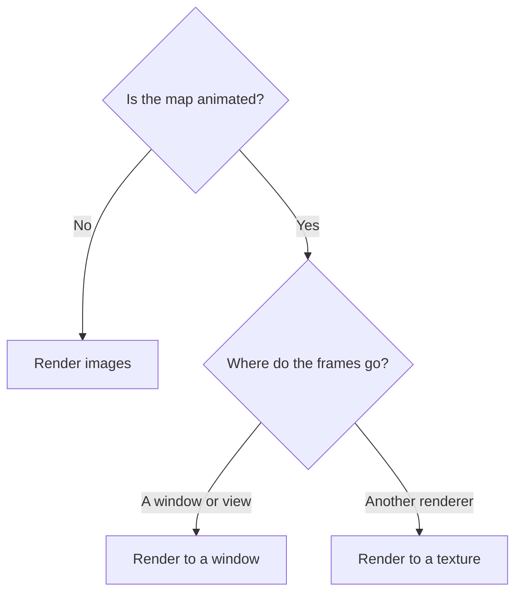

import { LinkCard } from "@astrojs/starlight/components";

A  draws one map into one target: a surface that
presents to a window, or a texture that your code reads or draws. The
 decides when the map renders: continuously as it changes,
or once for each image you request.

<LinkCard
  title="Render images"
  href="/maplibre-native-ffi/guides/images/"
  description="For a map that doesn't move, create it in static mode for a region you choose, or in tile mode for map tiles. The library creates a GPU device and a texture on it, and you read the pixels."
/>

<LinkCard
  title="Render to a window"
  href="/maplibre-native-ffi/guides/window/"
  description="For an animated map in a window or view, create it in continuous mode and attach a surface. The session presents each frame to it."
/>

<LinkCard
  title="Render to a texture"
  href="/maplibre-native-ffi/guides/texture/"
  description="For an animated map in another renderer, such as a UI framework, a game engine, or a compositor, create it in continuous mode and attach a texture. Your renderer draws each frame from it."
/>

Surfaces and textures use your graphics objects, for the graphics backend you
chose when you installed the library. See
[Install](/maplibre-native-ffi/install/#choose-a-backend).
