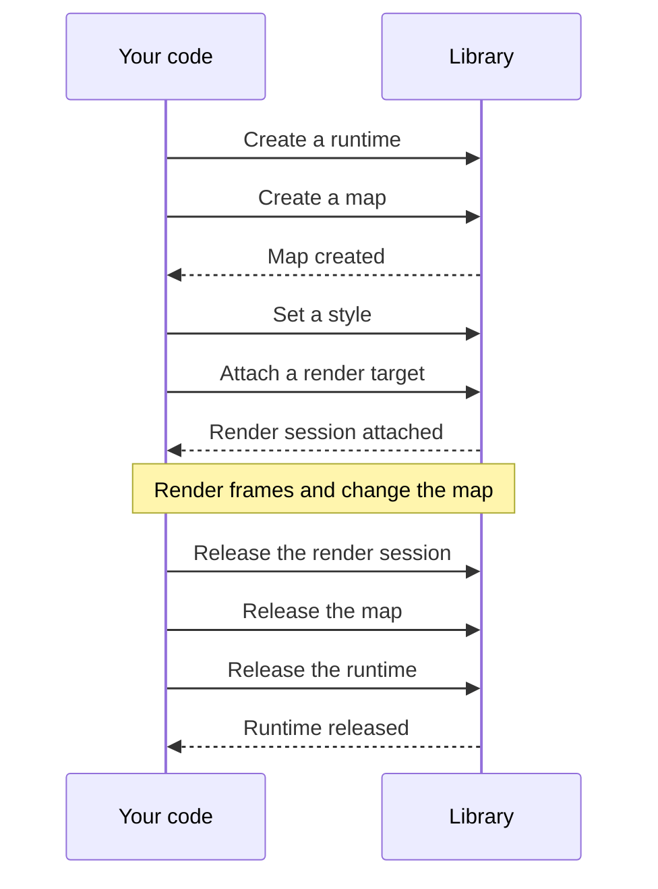

import { Aside } from "@astrojs/starlight/components";

import Snippet from "../../../components/Snippet.astro";

You primarily work with three stateful objects:

- A  is the main configuration context for how the map
  operates, including network and cache.
- A  belongs to a runtime, and holds a single map's state, like
  its style and camera.
- A  belongs to a map, and holds the renderer that
  draws it into a target, such as a texture or a window.

To avoid a leak, release each of these when you're done with it.

This guide creates a runtime and a map, releases them, and covers how calls
complete and fail.
[Choose a render target](/maplibre-native-ffi/guides/choose-a-target/) covers
the target.

## Create a runtime

Create a runtime. Without , it uses the defaults.
Usually, one runtime is all you need for all your maps.

<Snippet page="create-a-map" region="runtime" />

## Create a map

Create a map on the runtime with , and give it a size in
logical pixels, a scale factor, and a map mode. The scale factor and the mode
can't change later. For the mode, see
[Choose a render target](/maplibre-native-ffi/guides/choose-a-target/).

Wait for the map to be ready before you attach a render target.

<Snippet page="create-a-map" region="map" />

## Set a style

Set the map's style by URL with  or by JSON with
. To work with the map style in detail, see
[Style](/maplibre-native-ffi/guides/style/).

<Snippet page="create-a-map" region="style" />

## Wait for results

Most work is coordinated by the map runtime on its own thread, so most calls are
asynchronous. The library queues your work and then reports the result, either
with a callback or with your language's idiom for asynchronous operations.

Operations happen in the order you send them, so you generally only need to wait
for the result you need, not every call on the way.

<Snippet page="create-a-map" region="wait" />

Some information is reported to your integration as events. See
[Events and logs](/maplibre-native-ffi/guides/events-and-logs/) to listen for
events.

Some calls fail immediately, and others report a failure through their
asynchronous result. See your language's API reference for how each call can
fail. Every failure carries a  and a message.

<Snippet page="create-a-map" region="errors" />

## Release

Release the render session, the map, and the runtime, in that order. Where your
language has scoped cleanup, such as `await using` or `with`, leaving the scope
cleans them up in that order.

<Aside type="note">
  Even in a language with a garbage collector, release them yourself. The
  binding reports a leak if the collector finds one still open.
</Aside>

<Snippet page="create-a-map" region="close" />
