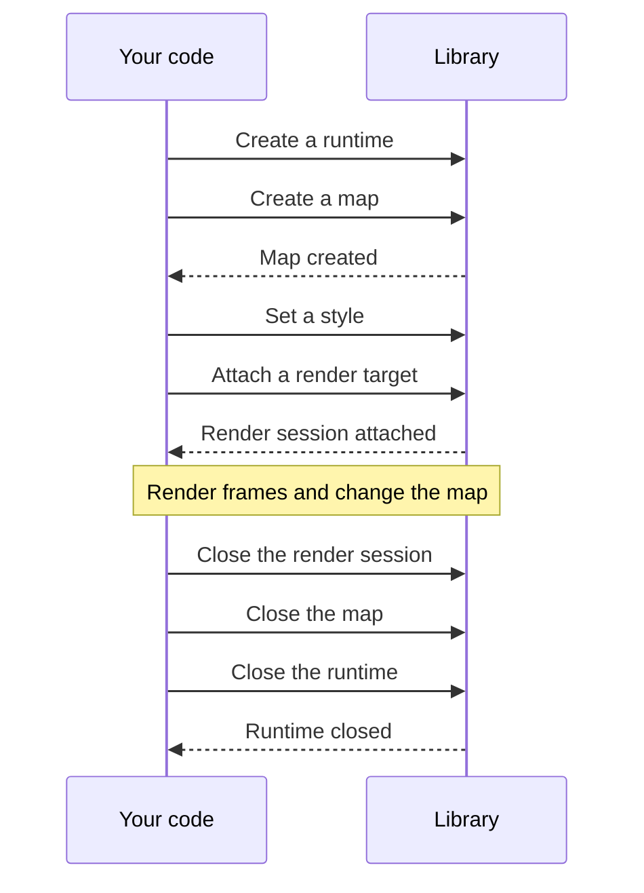

import { Aside } from "@astrojs/starlight/components";

import Snippet from "../../../components/Snippet.astro";

You work with three objects. A runtime holds what its maps share, such as the
network and the cache. A map belongs to a runtime, and holds a style, a camera,
and data. A render session belongs to a map, and draws it into a target, such as
a window.

This guide creates a runtime and a map, closes them, and covers how calls
complete and fail.
[Choose a render target](/maplibre-native-ffi/guides/choose-a-target/) covers
the target.

## Create a runtime

Create a  with the default options. One runtime can serve all
your maps. To set a cache file, see
[Offline](/maplibre-native-ffi/guides/offline/).

<Snippet page="create-a-map" region="runtime" />

## Create a map

Create a  on the runtime, and give it a size in logical pixels, a
scale factor, and a map mode. The scale factor and the mode can't change later.
For the mode, see
[Choose a render target](/maplibre-native-ffi/guides/choose-a-target/).

Wait for the map to be created before you attach a render target.

<Snippet page="create-a-map" region="map" />

## Set a style

Set the map's style by URL with . You don't need to
wait for it to load. To load style JSON or change the style, see
[Style](/maplibre-native-ffi/guides/style/).

<Snippet page="create-a-map" region="style" />

## Wait for results

Most calls return before their work is done. The library does the work later, in
the order you sent it, and then reports the result. Wait for the result when
your next step depends on it, or ignore it.

<Snippet page="create-a-map" region="wait" />

The library reports what you didn't ask for, such as a style that finished
loading, as events. See
[Events and logs](/maplibre-native-ffi/guides/events-and-logs/).

## Handle errors

A call fails in one of two ways. Either it fails right away when an argument or
the object's state is wrong, or it starts and its result reports a failure. Each
binding reports both with its language's own errors, and every failure has a
 and a message that describes it.

<Snippet page="create-a-map" region="errors" />

## Close

Close the render session, the map, and the runtime, in that order. Wait only for
the runtime: it finishes closing after its maps.

<Aside type="note">
  Even in a language with a garbage collector, close them yourself. The binding
  reports a leak if the collector finds one still open.
</Aside>

<Snippet page="create-a-map" region="close" />
