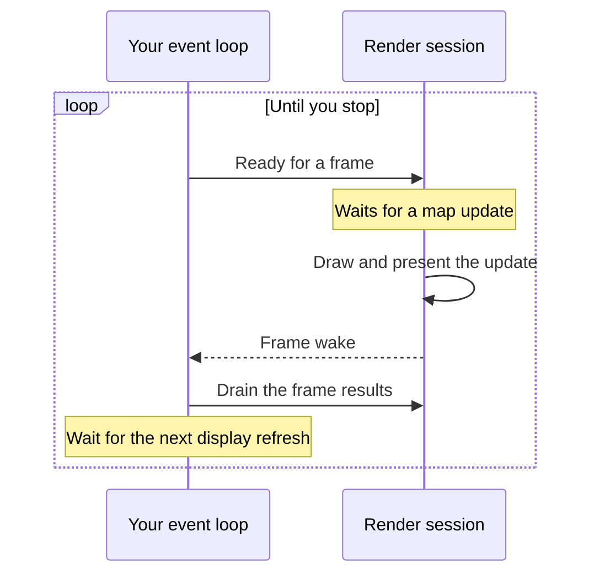

import { Aside } from "@astrojs/starlight/components";

import Snippet from "../../../components/Snippet.astro";

This guide shows how to present a continuous map in a native window or surface,
and keep it updated as the map changes. Start with a runtime and a continuous
map from [Create a map](/maplibre-native-ffi/guides/create-a-map/).

## Attach a surface

First, create the window with your platform or windowing library, and get the
surface handle for your backend:

- Metal: a
  [`CAMetalLayer`](https://developer.apple.com/documentation/quartzcore/cametallayer)
- Vulkan: a
  [`VkSurfaceKHR`](https://registry.khronos.org/vulkan/specs/latest/man/html/VkSurfaceKHR.html)
- OpenGL: an
  [`EGLSurface`](https://registry.khronos.org/EGL/sdk/docs/man/html/eglCreateWindowSurface.xhtml)
  with EGL, or an
  [`HDC`](https://learn.microsoft.com/en-us/windows/win32/gdi/device-contexts)
  with WGL
- WebGL: a
  [`<canvas>`](https://developer.mozilla.org/en-US/docs/Web/HTML/Reference/Elements/canvas),
  either through a WebGL context that you create on it with
  [`emscripten_webgl_create_context`](https://emscripten.org/docs/api_reference/html5.h.html#c.emscripten_webgl_create_context),
  or by its selector, which the library
  [transfers](https://developer.mozilla.org/en-US/docs/Web/API/HTMLCanvasElement/transferControlToOffscreen)
  to a worker
- WebGPU: a
  [`WGPUSurface`](https://webgpu-native.github.io/webgpu-headers/Surfaces.html),
  which a browser creates from a
  [`<canvas>`](https://developer.mozilla.org/en-US/docs/Web/HTML/Reference/Elements/canvas)

<Aside type="note">
  The snippets below use Vulkan. For another backend, attach and replace the
  surface with that backend's calls. The other steps are the same.
</Aside>

Attach the surface to the map at the window's size in logical pixels. The
session renders at the scale factor that you created the map with. To move the
window to a display of another density, create a new map and attach a new
session. You also pass a frame wake callback here, covered in the next section.

The  picks which thread runs the
session's graphics work. Usually that's the library's own thread. If the surface
uses your OpenGL or WebGPU context, use your graphics thread instead, since that
context belongs to your thread. See [Service driver work](#service-driver-work).

<Snippet page="window" region="attach" />

## Render frames

The map updates on the runtime's thread whenever something changes, like the
camera moving or a tile loading. Your app decides when to show those updates, at
most once per display refresh.

When you're ready for a frame, call  with
. You can start as soon as the attach
call returns. The session waits until the map has something new to show, then
draws and presents it. After the frame's result arrives, demand the next frame
at the next display refresh.

The  tells you that results
are ready. It can run on a library thread, so have it schedule a drain of the
results on your event loop with .

<Snippet page="window" region="frame-wake" />

If a result is , close the session and attach a
new one. To end the loop, such as before you close the session, stop demanding
frames.

<Snippet page="window" region="frame-loop" />

## Resize the window

When the window's size changes, resize the session with
. The session resizes the map for you.

<Snippet page="window" region="resize" />

## Handle a lost surface

Platforms can take the surface away, for example when your app goes to the
background. Rather than closing the session, release its target, so the map
keeps its tiles and renderer state for when the surface comes back.

Stop the frame loop and release the target with
 before the platform destroys the
surface. When the platform gives you a surface again, set it and its size as the
session's target, and restart the frame loop. The session keeps the graphics
context that it attached with.

<Snippet page="window" region="lost-surface" />

## Service driver work

With the graphics-thread driver, the session does its graphics work only when
you service it with  on your
graphics thread, with the target's context current.

The  tells you when
there's work to do. Each time it fires, schedule a service on your graphics
thread, even while the frame loop is stopped, and until the session's disposal
completes. A disposed session detaches at its next service, which frees its
graphics objects on your context. If you release the map before that service,
the session keeps its graphics objects until the process exits.

<Snippet page="window" region="service" />
