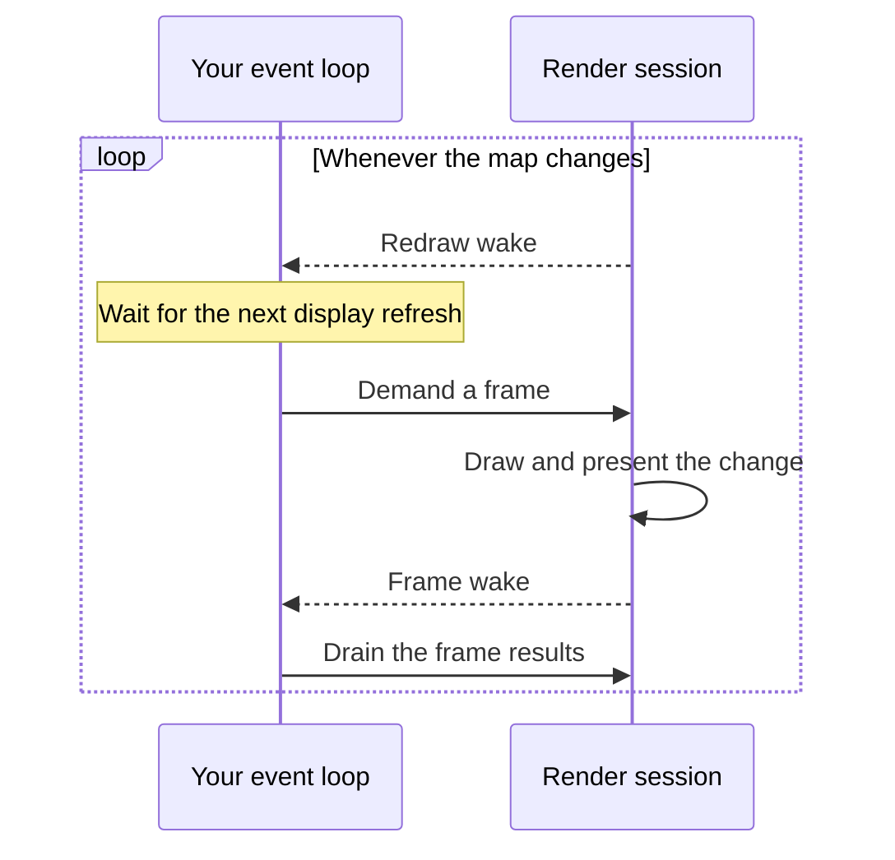

import { Aside } from "@astrojs/starlight/components";

import Snippet from "../../../components/Snippet.astro";

This guide shows how to present a continuous map in a native window or surface,
and keep it updated as the map changes. Start with a runtime and a continuous
map from [Create a map](/maplibre-native-ffi/guides/create-a-map/).

## Attach a window

First, create the window with your platform or windowing library, and describe
it to the library as an  of the kind that names it:

- Apple platforms: a
  [`CAMetalLayer`](https://developer.apple.com/documentation/quartzcore/cametallayer)
- Windows: the window's `HWND`
- Linux and FreeBSD: a Wayland `wl_surface` and its `wl_display`, or an X11
  `Window` and its Xlib `Display`
- Android: the window's `ANativeWindow`
- OpenHarmony: the `OHNativeWindow` of an `XComponent`
- A browser: an
  [`OffscreenCanvas`](https://developer.mozilla.org/en-US/docs/Web/API/OffscreenCanvas),
  such as one that the page
  [transferred](https://developer.mozilla.org/en-US/docs/Web/API/HTMLCanvasElement/transferControlToOffscreen)
  to the library's Web Worker, or a
  [`<canvas>`](https://developer.mozilla.org/en-US/docs/Web/HTML/Reference/Elements/canvas)
  when the library runs on the page's thread, in a 

<Aside type="note">
  The snippets below use a Wayland surface. For another platform, describe its
  window instead. The other steps are the same.
</Aside>

Attach with . The session renders on the
 that you pass, or on a device of the platform's own
backend that it creates when you pass none. Create a device with
 to share it among sessions, or to pick the backend
or the GPU.

Attach the window at its size in logical pixels. The session renders at the
map's scale factor. You also pass a redraw wake and a frame wake here, covered
in the next section.

The  picks which thread runs the
session's graphics work. For a window, that's the library's own thread. A WebGPU
surface uses your device, so it runs on your graphics thread instead. See
[Service driver work](#service-driver-work).

<Snippet page="window" region="attach" />

## Render frames

The map updates on the runtime's thread whenever something changes, like the
camera moving or a tile loading. Your app decides when to show those updates, at
most once per display refresh.

The  tells you that the
session has something new to draw. At your next display refresh, call
 without flags. The session draws the
change and presents it. The redraw wake isn't called again until you demand a
frame, so a map that doesn't change costs nothing.

A frame shows every command that you sent before you demanded it.

The  tells you that results
are ready. Both wakes can run on a library thread, so have them schedule work on
your event loop: the demand at the next refresh, and a drain of the results with
.

<Snippet page="window" region="frame-wake" />

If a result is , release the session and attach
a new one.

<Snippet page="window" region="frame-loop" />

## Resize the window

When the window's size changes, or it moves to a display with another scale
factor, resize the session with . The session
resizes the map for you, and keeps the tiles that it loaded.

<Snippet page="window" region="resize" />

## Handle a lost surface

Platforms can take the surface away, for example when your app goes to the
background. Rather than releasing the session, release its target, so the map
keeps its tiles and renderer state for when the surface comes back.

Release the target with  before you
destroy the surface. On Android and OpenHarmony, the platform destroys the
window, so release the target when it does. You don't need to wait for the
release to complete, because the session keeps its own reference to the window.
The session doesn't call the redraw wake while it has no target. When the
platform gives you a surface again, set it and its size as the session's target,
and the redraw wake asks for a frame again.

<Snippet page="window" region="lost-surface" />

## Service driver work

With the graphics-thread driver, such as for a WebGPU surface on your device,
the session does its graphics work only when you service it with
 on your graphics thread.

The  tells you when
there's work to do. Each time it fires, schedule a service on your graphics
thread, even while the frame loop is stopped. After you release the session,
keep servicing it until the release completes, so it can free its graphics
objects on your context. If you release the map first, the session keeps those
objects until the process exits.

<Snippet page="window" region="service" />
